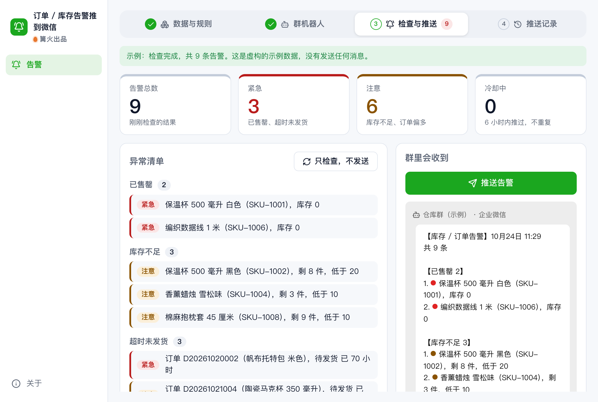

# 订单 / 库存告警推到微信

> 篝火出品 · 收录于篝火 App 应用区

读库存表和订单表，异常时推到企业微信 / 钉钉 / 飞书群机器人（群里的人用微信、企业微信、钉钉或飞书都能收到）



## 下载

到 [Releases](https://github.com/campfire-code/wechat-alert-push/releases/latest) 下载对应安装包：

| 电脑 | 文件 |
|---|---|
| Windows 10 / 11 | `wechat-alert-push_版本号_windows-x64-setup.exe` |
| Mac（Apple 芯片） | `wechat-alert-push_版本号_mac-arm64.dmg` |
| Mac（Intel 芯片） | `wechat-alert-push_版本号_mac-x64.dmg` |

第一次打开：
- **Windows**：如果弹出「Windows 已保护你的电脑」，点「更多信息」→「仍要运行」。
- **Mac**：如果提示「无法验证开发者」，打开「系统设置 → 隐私与安全性」，在下方点「仍要打开」。

## 怎么用

1. **选表格**：「库存表」选 `.xlsx` 或 `.csv`，「订单表」同理，两个可以只选一个。工具自动对应列（商品编码、商品名称、库存、安全库存；订单号、订单状态、下单时间、商品），对错了用下拉框改。
2. **设规则**：已售罄（库存 ≤ 0）、库存不足（低于 N 件，表里有「安全库存」列时优先按它）、超时未发货（状态含「待发货」等，超过 N 小时）、某状态订单过多（如退款中、售后中达到 N 单）。每条可单独开关。「N 小时内不重复推」避免同一条告警反复刷屏。
3. **加群机器人**：在企业微信 / 钉钉 / 飞书群里添加自定义机器人，把机器人地址（Webhook）粘贴进来；钉钉、飞书如开了「加签」或「关键词」安全设置，同时填密钥或关键词。点「测试」会发一条测试消息。**机器人地址和密钥只存本机设置，界面里以密码形式显示，推送记录和报错里不出现。**
4. **推送**：「只检查，不发送」先看会推什么；确认无误点「推送告警」。也可勾选「每 N 分钟自动检查并推送」（最短 5 分钟；**只在本工具窗口开着时有效**，关掉窗口就停）。
5. 消息按类型分组，超长自动分条；每次每个渠道最多发 5 条，超出的只写「另有 N 条未列出」。有一个渠道推送成功，这批告警就进入冷却。

### 核实来源与限制

| 事项 | 状态 | 来源 |
|---|---|---|
| 企业微信群机器人：地址 `https://qyapi.weixin.qq.com/cgi-bin/webhook/send?key=…`；text 内容最长 2048 字节（UTF-8）；每个机器人每分钟最多 20 条 | 已核实（2026-10-23） | 企业微信开发者中心「群机器人配置说明」 |
| 飞书自定义机器人：请求体不超过 20 KB；每个机器人每分钟 100 次、每秒 5 次；签名 = 对空串做 HmacSHA256，密钥为「秒级时间戳\n密钥」，时间戳与当前相差不超过 1 小时；错误码 19021 / 19024 / 11232 的含义 | 已核实（2026-10-23） | 飞书开放平台「自定义机器人使用指南」 |
| 钉钉自定义机器人：地址格式、加签算法（HmacSHA256，时间戳\n密钥）、每分钟 20 条与限流时长、内容长度上限、错误码 | **未核实**（文档页正文无法读取），代码按已知做法实现，以钉钉官方文档为准；真机用「测试」按钮确认 | — |
| 企业微信、钉钉的错误码含义 | **未核实**，界面原样显示平台返回的说明 | — |

已知限制：只发纯文本；不支持 .xls（请另存为 .xlsx）；定时检查依赖窗口常开；本工具不改动原表格。目录里写的上游 easychen/wecomchan 是「通过企业微信应用推送到个人微信」的服务端，本工具没有复制其代码，只发群机器人，不走应用消息。


## 验收用例

样例在 `samples/`：`库存表-示例.xlsx`（8 个商品，虚构）、`订单表-示例.xlsx`（9 个订单，下单时间在 2026-10-20 至 23 日）。

1. 打开工具，库存表选 `库存表-示例.xlsx`。应自动对上四列，页面出现 **5 条告警**：已售罄 2（SKU-1001、SKU-1006）、库存不足 3（SKU-1002 剩 8 低于其安全库存 20；SKU-1004、SKU-1008 无安全库存，按 10 件判断）。SKU-1007 库存 14 高于其安全库存 10，不报。
2. 订单表选 `订单表-示例.xlsx`，应自动对上列；示例订单时间是固定的，所以结果随检查日期变：在 2026-10-26 之后检查，「超时未发货」应出现 D20261020002、D20261021004、D20261022008、D20261023009 共 4 单（状态为待发货 / 已付款且超过 24 小时），已发货的订单不应出现；「订单状态」应出现 1 条：退款中、售后中共 3 单，达到 3 单。
3. 添加渠道，选「企业微信」，填 `https://qyapi.weixin.qq.com/cgi-bin/webhook/send?key=123`，点「测试」：这不是真实机器人，应看到失败提示（来自平台的错误说明，不会出现你填的 key）；填入自己群里的真实地址再测试，群里应收到「【测试】…」。
4. 地址填成 `https://example.com/x`，应立即提示「这不像企业微信群机器人地址」，不会发请求。
5. 用真实机器人点「推送告警」→「确认发送」，群里收到分组的告警消息；再点一次，应提示「N 条告警都在冷却期内，已推送过，未重复发送」；点「全部重发」才会重发。
6. 把规则「库存不足」关掉再检查，库存不足的 3 条应消失。
7. 自动化测试：`pnpm test`，覆盖表头识别、规则、冷却、分条、签名（与 node:crypto 独立对照）、三个平台请求体与返回解析、整个推送流程（假的网络请求），不联网。


## 自己编译

需要 Node.js 22、pnpm、Rust。

```bash
pnpm install
pnpm test          # 单元测试
pnpm tauri dev     # 开发运行
pnpm tauri build   # 打包
```

界面框架在 `src/kit`（所有 campfire-code 工具共用），本工具的逻辑在 `src/tool`。

## 致谢

产品思路参考开源项目 [easychen/wecomchan](https://github.com/easychen/wecomchan)（MIT，企业微信消息推送服务）；本工具没有复制其代码。

## 归属

本工具由**篝火**出品，是篝火 App 应用区收录的开源工具之一，由篝火（GitHub 组织 [campfire-code](https://github.com/campfire-code)）维护与更新。全部工具的目录见 [toolkit-hub](https://github.com/campfire-code/toolkit-hub)。

## 许可证

MIT，版权方为篝火（campfire-code）。
